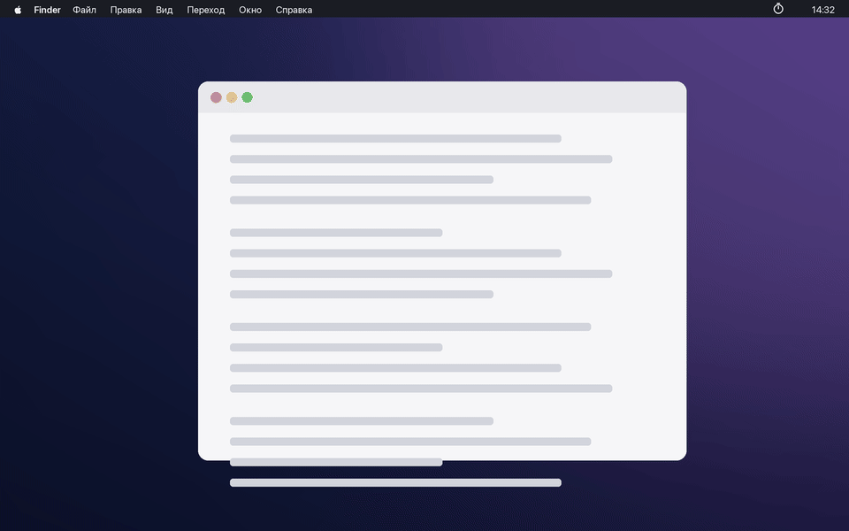

# Timer

Секундомер в меню-баре macOS. Одна кнопка, лог в CSV.



- Открыть панель: свайп одним пальцем от левого края трекпада, `⌃⌥⌘T` или клик по значку.
- **Пробел** — старт / пауза. `⌘⏎` — завершить сессию.
- Каждый непрерывный отрезок — строка в `~/Documents/time_log.csv`:

```
session_start,start,end,task
2026-03-11 09:12:40,2026-03-11 09:12:40,2026-03-11 10:03:15,—
```

Длительность не хранится, это `end − start`. Пример за три дня — `example/time_log.csv`.

## Установка

```
./install.sh              # собрать, положить в ~/Applications, автозапуск при входе
./install.sh --uninstall
```

macOS 13+, нужны только Command Line Tools: `xcode-select --install`.

## Сводка

```
python3 report.py --days 30
```

Другой путь к логу: `defaults write com.ivanevtushenko.timer logPath ~/x/time_log.csv`, затем «Перезапустить» в меню значка.
